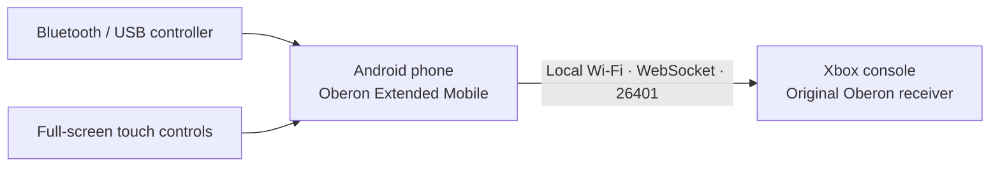

<div align="center">

# OBERON **EXTENDED MOBILE**

**Turn your Android phone into a controller for your Xbox.**

An Android edition of the Oberon Remote Input experience, with a green Xbox-inspired interface, on-screen controls, and support for compatible Bluetooth/USB controllers.

[](https://github.com/kuaan08/Oberon/releases)
[](https://github.com/kuaan08/Oberon/releases)
[](https://github.com/kuaan08/Oberon/releases)
[](LICENSE)

### [Download for Android](https://github.com/kuaan08/Oberon/releases) · [Latest Mobile Alpha](https://github.com/kuaan08/Oberon/releases/tag/mobile-v0.5.0-alpha.5) · [Original Oberon](https://github.com/SamsidParty/OberonRemote)

</div>

---

## What is Oberon Extended Mobile?

**Oberon Extended Mobile** lets you use an Android phone as the input sender for the original **Oberon Remote Input** application on an Xbox. It offers two ways to play:

- **Bluetooth / USB:** pair a compatible gamepad with Android and forward its input to the Xbox. This is the default mode when you open the app.
- **Virtual touch controller:** open a full-screen controller on your phone. Choose portrait or landscape, adjust the button sizes, and play using multiple fingers.

The phone and Xbox communicate directly over your **local Wi-Fi network**. **You do not need to run the Windows desktop app**, but you **do need the original Oberon receiver running on your Xbox**.



This Android project is an experimental extension of the Oberon ecosystem. It is not an Xbox emulator, does not replace the Xbox application, and is not affiliated with Microsoft.

## Download and install

**[Open the official Downloads / Releases page](https://github.com/kuaan08/Oberon/releases)**

1. Open **Releases** and select the most recent entry titled **Oberon Extended Mobile (Android)**.
2. Download the `.apk` file from the **Assets** section of that release.
3. Open the APK on your Android device and approve installation if Android prompts you.
4. Open **Oberon Extended Mobile**. It starts on the Bluetooth / USB dashboard by default.

**Requirements:** Android **8.0 or newer**, a phone and Xbox on the same local network, and the original Oberon app installed on the Xbox. A Bluetooth/USB controller is optional if you prefer the on-screen controls.

> **Development status:** Alpha 5 is a test build, not a fully verified stable release. The current APK is debug-signed. If Android reports a signature conflict when updating from an earlier alpha, you may need to uninstall the old preview first (back up your preferences if needed).

## Connect to Xbox — four easy steps

1. **Same Wi-Fi.** Connect both your phone and Xbox to the same trusted home network.
2. **Start on Android.** Tap **Iniciar servidor** (Start server). The app shows your phone's local IP address, for example `192.168.1.20:26401`. Use the address **shown on your own device**.
3. **Connect on Xbox.** Open the **original Oberon Remote Input** application on Xbox, enter your phone's displayed IP/port and connect.
4. **Choose your controls.** Play using a connected Bluetooth/USB controller, or tap **Abrir controle virtual** for full-screen touch controls.

The dashboard shows whether a client is connected. You can stop the local server with **Parar servidor**. If the Xbox cannot connect, verify the Wi-Fi network, the IP address, and whether the server is active.

## Features

| Area | What you can do |
| --- | --- |
| **Android dashboard** | Portrait/landscape layout, server start/stop, local IP, connection status and copy-IP button. |
| **Physical gamepads** | Use up to four USB/Bluetooth gamepads in separate Xbox slots when Android delivers their events. Identification covers Xbox-like, PlayStation-like, Nintendo and generic devices. |
| **Full-screen touch** | Two analog sticks, ABXY, D-pad, triggers, shoulders, View/Menu/Guide and independent multi-touch pointer tracking. |
| **Orientation** | Set the whole application's orientation to **Automatic**, **Vertical** or **Horizontal**; choose the virtual controller's orientation separately. |
| **Control customization** | Adjust overall size, separate analog-stick and face-button sizes, opacity, analog deadzone, touch vibration and animations. |
| **Themes** | Xbox Green, Xbox Light, **AMOLED Black**, Midnight, Graphite, Violet and Ocean. Dialogs and system bars follow the theme where supported. |
| **Detailed mode** | Optional controller and connection information on the main dashboard. |
| **Diagnostics** | Controller name/type, Android vendor/product identifiers, supported axes, optional battery report, connection count, packet counters and request intervals. |
| **Experimental settings** | Normal, ROOT or Shizuku background capture, preferred controller, 4-slot support, Xbox rumble, alternative right-stick axes, inverted Y, swapped A/B and TCP_NODELAY. |
| **Updates** | Check public Android Alpha/Beta releases from inside the app and open the official release/download link. Nothing is installed silently. |
| **Background connection** | Android foreground service with a notification to keep the local WebSocket server available. |

### Home screen, Settings and touch control

**Home screen:** Manage the Xbox connection, see your phone's IP, discover a connected physical gamepad and launch the virtual controller.

**Settings:** Switch themes, change portrait/landscape preferences, resize the virtual controller, adjust sensitivity and animations, choose a preferred controller, or restore default settings. Experimental options are separated from the normal experience.

**Touch controller:** The gameplay interface fills the screen instead of sharing space with menus. A **Voltar** (Back) button returns you to the dashboard. Multi-touch allows holding a stick while pressing other buttons.

### Diagnostics and latency: what the numbers mean

Oberon Extended Mobile displays actual received input requests, sent responses, and the average interval between requests coming from the Xbox application. These are useful for debugging connection stability.

**The request interval is not Xbox ping, total input latency, or game response time.** The existing receiver protocol does not report the timestamps required to measure end-to-end latency. TCP_NODELAY can change local TCP buffering behavior, but it does not boost Wi-Fi signal strength or guarantee lower latency.

The app shows a controller's battery only if Android and that controller's driver provide battery information. **Unknown battery** means the information was not available; it does not mean the battery is empty.

### Background controller capture: normal, ROOT or Shizuku

When Oberon Extended Mobile is minimized, Android normally stops delivering controller `KeyEvent` and `MotionEvent` data to the app. The **foreground service keeps the Xbox WebSocket server running, but does not capture gamepad input by itself**.

Alpha 5 includes an **optional ROOT experimental reader** that uses Android's `getevent` tool on the *selected gamepad's* `/dev/input/event*` device, rather than depending on Activity focus. When supported by the controller, this can send buttons, analog sticks, triggers and the D-pad while the main app is minimized.

To test it:

1. Pair the physical controller with Android before starting the server.
2. Open **Configurações → Experimental → Captura em segundo plano**. Choose **ROOT (su/Magisk)** on rooted phones or **Shizuku (ADB)** on unrooted phones that have started Shizuku.
3. Read the permission warning. With ROOT, grant access in Magisk. With Shizuku, install and start the Shizuku service (wireless debugging on Android 11+) and authorize the connection.
4. Stop and restart the Xbox server after changing the capture mode.
5. Check **Modo detalhado** for capture status, then minimize the app and test your controller with the Xbox.

**Important:** ROOT requires superuser privileges; Shizuku runs with ADB/shell privileges and **does not grant root**. Both modes are **off by default** and are **unverified with physical controllers**. Shizuku may show **permission denied** for /dev/input on devices whose SELinux or filesystem permissions block shell access. SELinux restrictions, an unsupported driver, different Linux button/axis mappings or Android power management may prevent it from working. It does not work on ordinary unrooted Android devices, and it is not a guarantee of global input capture on every device. Only the selected gamepad event node is intended to be read, not the touch screen or general keyboard. The app does not store a raw input log.

## Troubleshooting

| Problem | What to try |
| --- | --- |
| The Xbox cannot connect | Check that both devices are on the same Wi-Fi, Android's server is running, and the Xbox is using the correct IP and port `26401`. |
| The physical controller is not detected | Pair it in Android settings, reconnect USB/Bluetooth, and check **Diagnóstico**. Try Experimental only if required. |
| The buttons are mapped incorrectly | Use Experimental options for alternative right-stick axes, A/B swap or inverted Y. |
| Touch controls are too small | Open **Configurações → Tela do controle** and resize the sticks and buttons; use portrait or landscape to suit the phone. |
| An update cannot install | An older preview may have a different debug signature. You may need to uninstall that build before installing the new one. |
| The battery is displayed as unknown | Some generic controllers do not expose their battery status through Android's driver. |

## Known limitations

- **Up to four Android controllers** can now occupy the original Xbox receiver's four independent slots while the app receives their events. The ROOT and Shizuku background readers still support only one selected physical controller; multigamepad hardware behavior needs testing.
- Normal Android gamepad capture works only while the app is focused. The optional ROOT background input reader is experimental, requires explicit permission and may not work on every device.
- **Rumble forwarding is experimental**: the Xbox's four motor values are mapped to each Android controller's vibrator only if Android exposes that controller's vibration API. Bluetooth/USB drivers may not support vibration. Virtual-pad phone rumble is opt-in.
- Real Xbox input latency and hardware compatibility have **not been validated across devices**.
- This project is for **trusted local networks**, not public hosting or internet-exposed port forwarding.

## Source and development

The full Android source is included here so the project can be reviewed and built:

| Location | Contents |
| --- | --- |
| [`mobile/`](mobile/) | Native Android application and tests |
| [`mobile/app/src/main/java/`](mobile/app/src/main/java/) | Interface, controller handling, network server and protocol |
| [`Oberon/`](Oberon/) | Original Xbox-side reference source retained for protocol compatibility |
| [`LICENSE`](LICENSE) | Original licensing and attribution requirements |

To compile yourself, install **JDK 17**, **Android SDK API 35**, and **Gradle 8.11.1**, then run:

```bash
cd mobile
gradle :app:testDebugUnitTest :app:assembleDebug
```

The resulting development APK is generated at `mobile/app/build/outputs/apk/debug/app-debug.apk`. Most users should simply download the APK from **[Releases](https://github.com/kuaan08/Oberon/releases)** rather than build from source.

## Credits and acknowledgments

This project exists because of the original Oberon Remote Input and the work that followed it. **Both original and extended credits are preserved deliberately.**

**Original Oberon Remote Input — [SamsidParty](https://github.com/SamsidParty/OberonRemote)**  
Creator of the original **Oberon Remote Input Desktop** application and Xbox receiver, and original maintainer of the protocol/codebase. Credit also belongs to all original contributors.

**Oberon Remote Extended — [katakishi0](https://github.com/katakishi0/OberonRemote)**  
Owner and maintainer of **Oberon Extended**, based on the original Oberon project. The Extended project also acknowledges and credits SamsidParty and the original Oberon contributors.

**Oberon Extended Mobile — Android edition**  
An Android adaptation of the Extended controller-sender experience, retaining compatibility with the original Xbox receiver and recognizing both the original and Extended projects above.

The [original license](LICENSE) and a link to [SamsidParty's repository](https://github.com/SamsidParty/OberonRemote) must accompany distributions. The original terms also require modified source to be publicly accessible and contain restrictions regarding Microsoft Store distribution.

---

<div align="center">

**[Download Android APK](https://github.com/kuaan08/Oberon/releases)** · **[Oberon Extended Desktop](https://github.com/katakishi0/OberonRemote)** · **[Original Oberon](https://github.com/SamsidParty/OberonRemote)**

</div>
